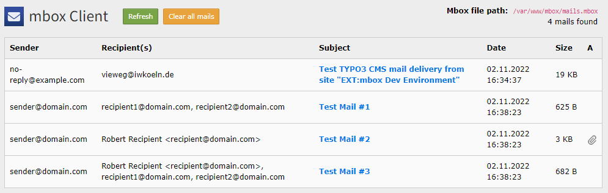
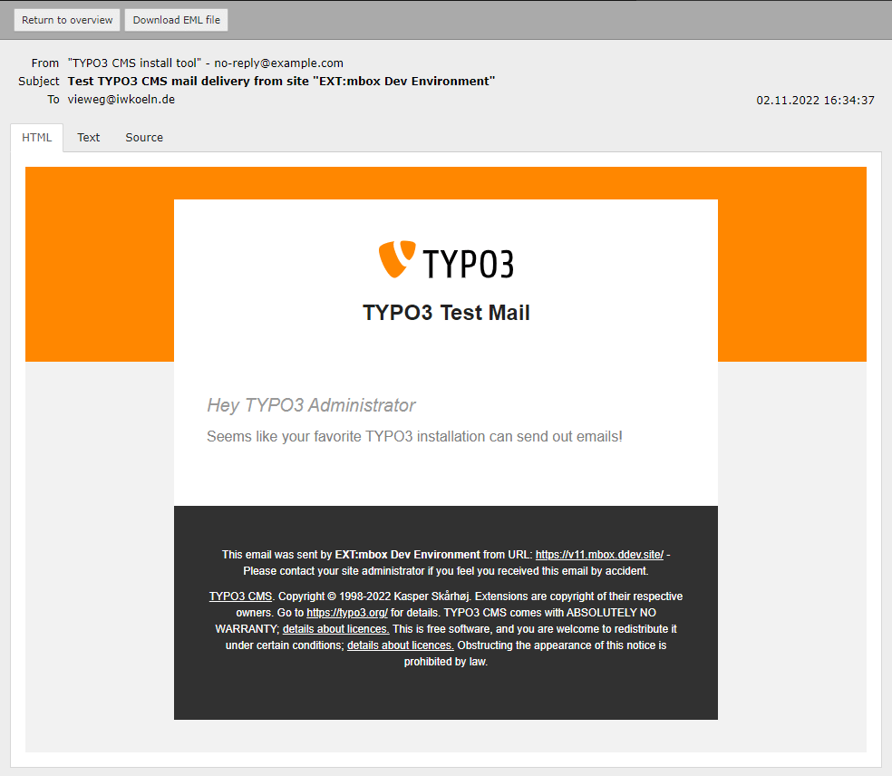
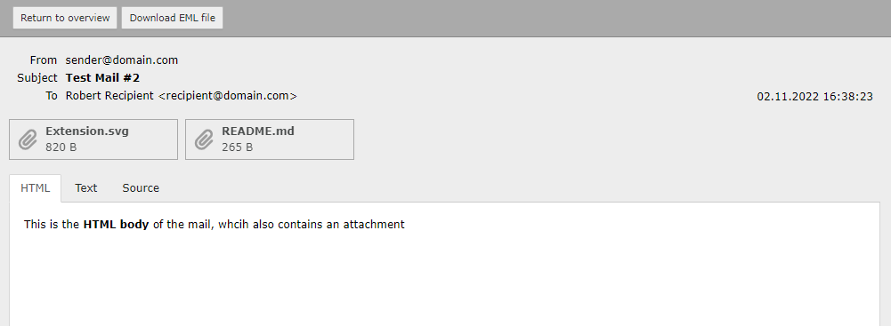

# EXT:mbox (Mail Client)

TYPO3 CMS backend module to view mbox file contents, like an email client.


## Screenshots

### Inbox view



### Detail view (with HTML output)



### Detail view (with attachments)




## Features

- Simple web mail client for emails stored in local mbox file
- Configurable pagination
- Possibility to disable the backend module
- Support for very large mbox files
- HTML and text viewer
- Download attachments separately
- Download whole mail message as EML file (e.g. for Microsoft Outlook)
- Clear mbox (delete all mails) action
- Provides RFC 4155 compliant mbox mail transport (`T3\Mbox\MboxTransport`)


## Requirements

- TYPO3 12.4 LTS, 13.4 LTS or 14.3 LTS
- PHP >=8.2

Notice: For TYPO3 11.5 LTS support checkout version 2.1.


## Installation

Just install the extension, like any other TYPO3 CMS extension.

Link to TER: https://extensions.typo3.org/extension/mbox

For Composer, you can use:

```bash
composer require t3/mbox
```

If you are upgrading an existing Composer installation, update the extension
and its parser dependency together. The extension now requires
[`armin/mbox-parser`](https://packagist.org/packages/armin/mbox-parser) 2.1 or later
within the 2.x series.

```bash
composer update t3/mbox armin/mbox-parser --with-all-dependencies
```

For TER release builds, see [the bundled dependency instructions](Resources/Private/PHP/README.md).

## Configuration

To make EXT:mbox work you need to configure the TYPO3 mail configuration to use mbox, like this:

```php
<?php

$GLOBALS['TYPO3_CONF_VARS']['MAIL']['transport'] = 'T3\Mbox\MboxTransport';
$GLOBALS['TYPO3_CONF_VARS']['MAIL']['transport_mbox_file'] = '/var/www/html/path/to/mbox-file.mbox';
```

If you have different transport configured, the backend module will display an error notice.


## Extension Settings

In extension settings (under Admin Tools > Settings > Extension Configuration) you have two options:

### Mails per page

The amount of mails being displayed per page. Default: 10

### Debug mode

For debugging and testing purposes, there is a Symfony command shipped, which becomes only available,
when you enable the debug mode in Extension configuration. 

Don't forget to clear all caches from install tool, after enabling the debug mode.

The command `mbox:testmails:send` sends six test mails (with and without attachments).

## Dev Environment

The extension repository provides a DDEV environment with PHP 8.4 for TYPO3 12.4, 13.4, and 14.3.
You find more information [here](https://github.com/a-r-m-i-n/ddev-for-typo3-extensions).

### Minimum instructions

```bash
ddev start
ddev install-all
```

To install only TYPO3 14.3, run `ddev install-v14` instead of `ddev install-all`.
If upgrading an existing local environment, `ddev delete -Oy` removes all local
TYPO3 installations and their data before you start again.

* Overview: https://mbox.ddev.site/
* TYPO3 12 Backend: https://v12.mbox.ddev.site/typo3/
* TYPO3 13 Backend: https://v13.mbox.ddev.site/typo3/
* TYPO3 14 Backend: https://v14.mbox.ddev.site/typo3/
* Username: `admin`
* Password: `Password:joh316` (also in install tool)

## Links

- [Git Repository](https://github.com/a-r-m-i-n/mbox)
- [Issue tracker](https://github.com/a-r-m-i-n/mbox/issues)
- [EXT:mbox in TER](https://extensions.typo3.org/extension/mbox)
- [EXT:mbox on Packagist](https://packagist.org/packages/t3/mbox)
- [The author](https://v.ieweg.de)
- [**Donate**](https://www.paypal.com/cgi-bin/webscr?cmd=_s-xclick&hosted_button_id=2DCCULSKFRZFU)
